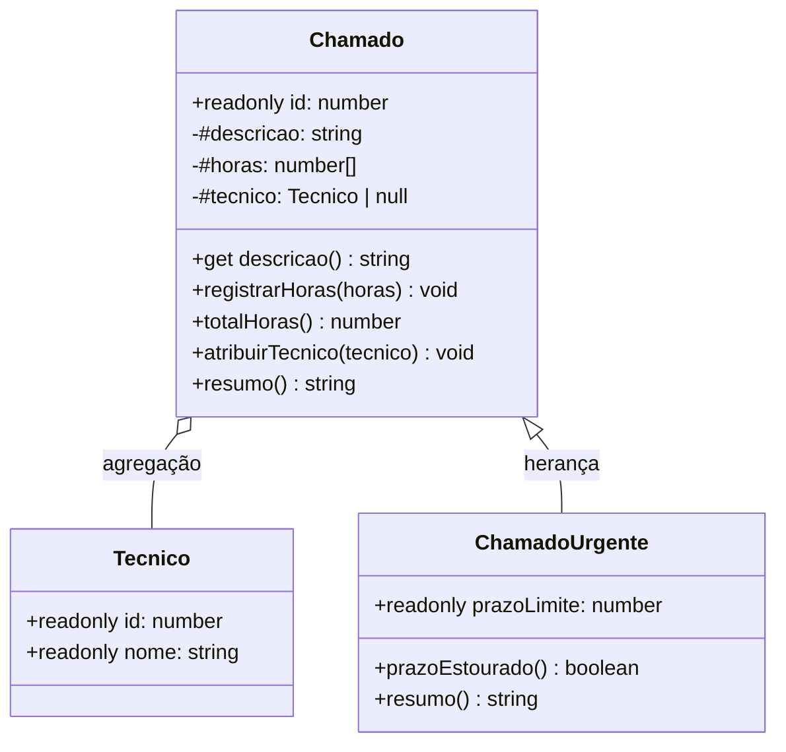

# Sistema de Chamados em TypeScript

Sistema simples de chamados de suporte técnico escrito em TypeScript. Exercita os pilares da Orientação a Objetos: **encapsulamento** com campos hard private (`#`), **validação de dados**, **agregação**, **herança** e **polimorfismo**.

## Como executar

É preciso ter o [Node.js](https://nodejs.org) instalado.

```bash
npx -p typescript tsc --target es2022 chamados.ts && node chamados.js
```

O `tsc` checa os tipos e gera o `chamados.js`, e o `node` executa esse JavaScript. O TypeScript em si nunca roda: os tipos são apagados na compilação (*type erasure*).

## Estrutura



### `Tecnico`
Guarda o `id` e o `nome` do técnico. Os dois campos são `readonly`.

### `Chamado`
| Membro | O que faz |
|---|---|
| `id` (`readonly`) | Número do chamado. Não pode ser alterado depois da criação. |
| `#descricao` | Texto do chamado. É hard private, e a leitura é feita pelo getter `descricao`. |
| `#horas` | Histórico de horas trabalhadas. Começa vazio. |
| `#tecnico` | Técnico responsável. Começa `null`. |
| `constructor(id, descricao)` | Lança erro se a descrição vier vazia. |
| `registrarHoras(horas)` | Adiciona horas ao histórico. Lança erro para zero ou negativo. |
| `totalHoras()` | Soma o histórico com um laço `for`. |
| `atribuirTecnico(tecnico)` | Associa um técnico ao chamado. |
| `resumo()` | Retorna o número, a descrição, o técnico e o total de horas. |

### `ChamadoUrgente extends Chamado`
| Membro | O que faz |
|---|---|
| `prazoLimite` | Prazo máximo de atendimento, em horas. |
| `constructor(id, descricao, prazoLimite)` | Repassa `id` e `descricao` para a classe mãe com `super`. |
| `prazoEstourado()` | Retorna `true` se o total de horas passou do prazo. |
| `resumo()` (`override`) | Reaproveita `super.resumo()` e acrescenta o aviso de prazo. |

## Conceitos aplicados

### Encapsulamento e invariantes
Os dados internos ficam em campos com `#`, que são isolados pelo próprio motor JavaScript em tempo de execução. É diferente do `private` do TypeScript, que some na compilação e pode ser burlado com `(obj as any).campo`.

Como a lista de horas só pode ser alterada por `registrarHoras`, que é a **porta única** de entrada, a regra "toda hora registrada é maior que zero" vale durante toda a vida do objeto.

### Agregação (`Chamado` → `Tecnico`)
O técnico é criado **fora** do chamado, e o chamado guarda só uma referência para ele. O mesmo técnico pode atender vários chamados. Se um chamado deixar de existir, o técnico continua existindo, porque ainda há outras referências apontando para ele.

### Herança (`ChamadoUrgente` → `Chamado`)
Um chamado urgente **é um** chamado com um prazo a mais. A classe filha reaproveita tudo da mãe (validação, registro e soma de horas) e só acrescenta o que é próprio dela.

### Polimorfismo e late binding
Os dois tipos de chamado ficam numa mesma lista `Chamado[]`, e o programa chama `resumo()` em cada um. O método executado depende do tipo **real** do objeto, decidido em tempo de execução (*late binding* / *single dispatch*). Por isso o chamado urgente mostra o aviso de prazo e o comum não. Na classificação de Cardelli & Wegner, é polimorfismo **universal por inclusão**.

## Testes incluídos no programa

1. Cria o técnico Carlos.
2. Cria um chamado comum, atribui o Carlos e registra 2h e depois 1h.
3. Cria um chamado urgente com prazo de 4h, atribui o Carlos e registra 3h e depois 2h. O prazo estoura.
4. Percorre os dois chamados numa mesma lista, chamando `resumo()` em cada um.
5. Testa as validações: descrição vazia e horas 0 e -5 são recusadas.
6. Teste de segurança: tenta acessar `#descricao` de fora da classe.

### Saída esperada

```
=== Resumo dos chamados ===
Chamado #101 - Impressora não liga | Técnico: Carlos | Total: 3h
Chamado #102 - Servidor fora do ar | Técnico: Carlos | Total: 5h | ⚠️ PRAZO ESTOURADO! (limite de 4h)

=== Testes de validação ===
Erro esperado: A descrição do chamado não pode ser vazia.
Erro esperado: Horas inválidas (0): informe um valor maior que zero.
Erro esperado: Horas inválidas (-5): informe um valor maior que zero.
Total do chamado 101 continua: 3h

=== Teste de segurança ===
Motor JS recusou chamado1.#descricao: SyntaxError: Private field '#descricao' must be declared in an enclosing class
(chamado1 as any).descricao = Impressora não liga
(chamado1 as any)['#descricao'] = undefined
Object.keys(chamado1) = [ 'id' ]
Técnico continua existindo: Carlos
```

### Sobre o teste de segurança
Escrever `chamado1.#descricao` diretamente no código faz o compilador recusar o arquivo:

```
error TS18013: Property '#descricao' is not accessible outside class 'Chamado' because it has a private identifier.
```

Para o programa continuar rodando, a tentativa é feita com `eval`, como se fosse digitada no console. Assim o motor JavaScript acusa o `SyntaxError` em tempo de execução. Além disso:

- `(chamado1 as any)['#descricao']` retorna `undefined`: não existe propriedade com esse nome.
- `Object.keys(chamado1)` mostra só `id`: os campos com `#` não aparecem.

## Autor

Lucas Coqueiro
